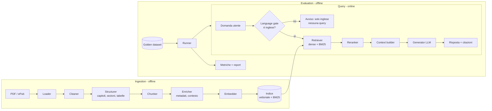

# Architettura — Q&A RAG su "The Triathlete's Training Bible"

> Scope attuale: **solo Q&A sul libro**. Obiettivo primario: capire il RAG in pratica e **misurarne la qualità**.
> Lingua: **solo inglese** per domande e risposte.
> Fuori scope (per ora): multilingua, generazione piani, calcolo zone, profilo atleta, integrazione dati Strava/Garmin.

---

## 1. Modello della conoscenza: perché il libro non è "solo testo"

Il libro contiene tre tipi di contenuto, che si comportano in modo molto diverso in un RAG:

| Tipo | Esempi | Problema nel RAG | Strategia |
|---|---|---|---|
| **Prosa narrativa** | filosofia di allenamento, limitatori, recupero, tapering | Pochi problemi: è il caso ideale | Chunking per sezione, retrieval semantico |
| **Tabelle e regole numeriche** | % delle zone su LTHR, ore settimanali per periodo/ore annue, durata dei mesocicli | Un chunker ingenuo **spezza le tabelle**; gli embedding catturano male i numeri; l'LLM tende a "interpolare" valori inventati | Estrarre le tabelle come **unità atomiche** (mai spezzate), in Markdown, con una didascalia testuale che descrive cosa contengono |
| **Descrizioni di workout** | codici e descrizioni degli allenamenti per abilità | Molto simili tra loro → retrieval confonde workout vicini | Un chunk per workout + metadati (sport, abilità, periodo) |
| **Figure e tabelle-immagine** | grafici, illustrazioni, alcune tabelle pubblicate come immagine | Sono pixel: un RAG testuale non ne vede il contenuto. Le tabelle-immagine sono le più critiche (numeri) | **Ora:** un blocco `figure` con la sola didascalia, per sapere che lì c'era una figura. **Futuro:** trascrizione/descrizione con la multimodalità di Claude (vedi roadmap, "Dopo") |

**Regola d'oro:** quando una risposta dipende da un numero, deve venire *letteralmente* da un chunk recuperato e citato.
In futuro (fase "coach") queste regole diventeranno **codice deterministico** (tool), e il RAG resterà per spiegare il *perché*.
Per ora, nel Q&A puro, trattarle bene nel chunking è sufficiente — ed è un ottimo banco di prova per la valutazione.

---

## 2. Vista d'insieme

Due pipeline separate, collegate solo dall'indice.



---

## 3. Pipeline di ingestion

| Step | Responsabilità | Note pratiche |
|---|---|---|
| **Loader** | Estrae testo grezzo da PDF/ePub | ePub è molto più pulito del PDF (struttura HTML già presente). Per PDF: `pymupdf`. |
| **Cleaner** | Rimuove header/footer, numeri di pagina, sillabazioni, artefatti | Ispeziona sempre l'output a mano: è dove nascono metà dei problemi di qualità. |
| **Structurer** | Ricostruisce gerarchia: parte → capitolo → sezione; isola tabelle e sidebar | Produce un `Document` strutturato, salvato in `data/processed/` come JSON. |
| **Chunker** | Divide in `Chunk` | Strategie intercambiabili (vedi §5). |
| **Enricher** | Aggiunge metadati e, opzionalmente, contesto generato | `chapter`, `section`, `page`, `content_type` (prose/table/workout), `sport`. |
| **Embedder** | Calcola vettori | Modello intercambiabile (vedi §6). |
| **Index** | Persiste vettori + indice lessicale | Per un libro (~1–3k chunk) basta un indice in memoria / su file. |

Ogni step produce un artefatto su disco → si può ispezionare, versionare (localmente) e rieseguire solo lo step cambiato.

---

## 4. Pipeline di query

1. **Language gate** — controllo locale e deterministico: se il messaggio non è in inglese, restituisce un avviso e **la pipeline si ferma** (niente retrieval, niente chiamate LLM). Vedi §4.1.
2. **Retriever** — ibrido:
   - *dense* (similarità coseno tra embedding) → coglie il significato;
   - *BM25* (lessicale) → coglie termini esatti ("Build 2", "LTHR", "Zone 5b").
   - Fusione con **Reciprocal Rank Fusion (RRF)**. Recupera un top-k largo (es. 20–30).
3. **Reranker** — un cross-encoder riordina i candidati e tiene i migliori (es. 5). Di solito è il miglioramento singolo più grande.
4. **Context builder** — formatta i chunk con ID e riferimento (capitolo/sezione/pagina), deduplica, rispetta un budget di token.
5. **Generator** — l'LLM risponde **solo** dal contesto, cita gli ID dei chunk, e dichiara "not in the book" quando serve. Risponde sempre in inglese.

### 4.1 Lingua: solo inglese (per ora)

Domande e risposte sono **solo in inglese**, la stessa lingua del libro. Così il retrieval non ha problemi cross-lingua (BM25 ed embedding confrontano testo inglese con testo inglese) e la pipeline resta semplice.

**Language gate** — primo step della pipeline, prima di qualsiasi costo:
- rilevamento **locale e deterministico** con `lingua-py`, limitato a un insieme ristretto di lingue (EN, IT, ES, FR, DE) per essere più preciso;
- messaggio non inglese → la pipeline restituisce un avviso fisso e **non esegue la query**:
  > *"I can only answer questions in English for now. Please rephrase your question in English."*
- **messaggi molto brevi** (es. meno di 3 parole: "LTHR?", "Build 2") o con confidenza bassa → **passano**. Il rilevamento su testi brevi è inaffidabile, e bloccare una domanda legittima è peggio che lasciar passare un caso dubbio;
- i termini del metodo (Build, LTHR, Zone 5b) sono già inglesi, quindi non creano problemi.

Il gate è una sola funzione (`is_english` in `language.py`), chiamata all'inizio di `answer()`: quando arriverà il multilingua, si sostituisce lì.

### Conversation design (Q&A)

- **Lingua:** solo inglese; i messaggi in altre lingue ricevono l'avviso del language gate.
- **Persona:** coach esperto, conciso, che cita le fonti ("Friel, cap. 7 — Base period").
- **Grounding:** nessuna affermazione senza citazione; se il contesto non basta lo dice esplicitamente invece di usare conoscenza generale.
- **Guardrail:** niente diagnosi mediche; su dolore/infortuni rimanda a un professionista.
- **Copyright:** riassume e parafrasa, non riproduce lunghi passaggi verbatim.
- **Multi-turn:** la domanda di follow-up viene riscritta come domanda autonoma (*condensation*) prima del retrieval: "and how long does it last?" → "How long does the Build period last?".

---

## 5. Strategie di chunking (da confrontare)

| Strategia | Descrizione | Quando vince |
|---|---|---|
| **Fixed-size + overlap** | N token con sovrapposizione | Baseline: semplice, serve per avere un riferimento |
| **Structure-aware** | Un chunk per sezione/sottosezione, split solo se troppo lunga; tabelle intatte | Libri ben strutturati come questo |
| **Contextual chunking** | A ogni chunk si antepone 1–2 frasi generate dall'LLM che lo collocano nel libro ("Questo passaggio, dal capitolo sul periodo Base, descrive…") | Chunk che da soli sono ambigui (pronomi, "questo periodo") |
| **Parent-child** | Si indicizzano chunk piccoli, ma si passa all'LLM la sezione "genitore" più ampia | Domande che richiedono contesto ampio |

---

## 6. Scelte tecnologiche iniziali

Ogni libreria esterna vive in un solo modulo (vedi §8): cambiarla tocca un file.

| Componente | Scelta iniziale | Alternativa da provare |
|---|---|---|
| Linguaggio | Python 3.12+, gestito con `uv` | — |
| Estrazione | `ebooklib` + `beautifulsoup4` (ePub) / `pymupdf` (PDF) | — |
| Embedding | `BAAI/bge-m3` locale (gratuito; multilingue, quindi già pronto per il futuro) | Voyage AI (API) |
| Indice vettoriale | In memoria con `numpy` (brute force: con pochi chunk è istantaneo e didattico) | LanceDB / Qdrant |
| Lessicale | `rank-bm25` | — |
| Reranker | `BAAI/bge-reranker-v2-m3` locale | Rerank via API |
| Language gate | `lingua-py` locale (nessuna chiamata LLM) | — |
| LLM generazione | Claude (`claude-sonnet-5-5`) via SDK `anthropic` | — |
| LLM judge (eval) | Claude (`claude-opus-5-5`) | — |
| Config | YAML + `pydantic` | — |
| UI (più avanti) | CLI → Streamlit/Gradio | — |

**Baseline long-context:** oltre al RAG, si implementa un `Generator` che riceve **l'intero libro** in contesto (con prompt caching), se entra nella finestra del modello. Confrontarlo col RAG nell'eval è il modo più istruttivo per capire quando il RAG serve davvero.

---

## 7. Valutazione

La valutazione è il cuore del progetto: **ogni cambiamento alla pipeline è un esperimento misurato**.

### 7.1 Golden dataset

File `eval/datasets/golden.jsonl`, una riga per domanda:

```json
{
  "id": "q-042",
  "question": "How long does the Base period typically last and how is it divided?",
  "category": "factual",
  "reference_answer": "…risposta scritta a mano…",
  "relevant_chunk_ids": ["ch07-s02-c01", "ch07-s02-c02"],
  "language": "en"
}
```

- **50–100 domande** scritte a mano (è tempo ben speso: le leggi e capisci il libro).
- **Categorie** (per vedere *dove* la pipeline sbaglia):
  - `factual` — un fatto in un punto preciso;
  - `table` — risposta in una tabella (numeri);
  - `conceptual` — spiegazione di un concetto;
  - `multi_hop` — richiede più sezioni;
  - `out_of_scope` — non è nel libro → la risposta corretta è dichiararlo;
  - `follow_up` — seconda domanda di una conversazione.
- Domande **sintetiche** generate dall'LLM a partire dai chunk sono utili per aumentare il volume, ma vanno **riviste a mano**.
- Domande tutte in **inglese**, più una categoria `non_english` (~10 messaggi in IT/ES/FR, più qualche caso limite: messaggi brevi, inglese con un termine straniero) per testare il language gate. Per questi la risposta attesa è l'avviso, con zero chunk recuperati.
- I `relevant_chunk_ids` dipendono dal chunking: si salvano anche come **span di testo/sezione**, così si rimappano automaticamente quando cambia la strategia di chunking.

### 7.2 Metriche di retrieval (deterministiche, economiche)

| Metrica | Domanda a cui risponde |
|---|---|
| **Hit rate@k** | Almeno un chunk rilevante è nei primi k? |
| **Recall@k** | Quale frazione dei chunk rilevanti è nei primi k? |
| **MRR** | Quanto in alto compare il primo chunk rilevante? |
| **nDCG@k** | Qualità complessiva dell'ordinamento |

Se il retrieval è scarso, nessun prompt salverà la generazione: si ottimizza **prima** il retrieval.

### 7.3 Metriche di generazione (LLM-as-judge)

| Metrica | Cosa misura |
|---|---|
| **Faithfulness / groundedness** | Ogni affermazione è supportata dal contesto recuperato? (anti-allucinazione) |
| **Answer correctness** | La risposta concorda con la `reference_answer`? |
| **Answer relevance** | Risponde davvero alla domanda? |
| **Citation accuracy** | I chunk citati supportano davvero le frasi a cui sono attaccati? |
| **Refusal correctness** | Su `out_of_scope` dice "non è nel libro" invece di inventare? |
| **Gate accuracy** | Il language gate blocca i messaggi non inglesi e lascia passare quelli inglesi? *Deterministica*: precision/recall sul blocco, senza judge. Un falso blocco su una domanda inglese è l'errore più grave. |

Buone pratiche per il judge:
- **Rubrica esplicita** con scala piccola (es. 1–3 o pass/fail) e motivazione prima del voto.
- **Calibrazione:** etichetta a mano ~30 risposte e misura l'accordo col judge prima di fidarti dei numeri.
- Judge di un modello diverso/più forte rispetto al generatore, temperatura 0.

### 7.4 Esperimenti

- Ogni esperimento = un file `configs/experiments/<nome>.yaml` (chunker, embedder, k, reranker, prompt, modello).
- Il runner salva in `eval/runs/<timestamp>-<nome>/`: config usata, output per domanda, metriche aggregate **per categoria**.
- Un report confronta due run fianco a fianco (delta metriche + domande che sono peggiorate).
- Si traccia anche **costo e latenza** per domanda.

---

## 8. Design del codice

Semplice: funzioni in pochi moduli (vedi `docs/steering/structure.md`). Le varianti da confrontare negli esperimenti sono **funzioni con la stessa firma in un dizionario**, scelte per nome dalla config:

```python
# chunking.py
CHUNKERS = {"fixed": fixed_size_chunks, "sections": section_chunks}

# retrieval.py
RETRIEVERS = {"dense": dense_search, "bm25": bm25_search, "hybrid": hybrid_search}


# qa.py
def answer(question: str, index: Index, llm: LLM, cfg: QAConfig) -> Answer:
    if not is_english(question):
        return Answer.not_english()
    candidates = RETRIEVERS[cfg.retriever](question, index, cfg.top_k)
    context = (
        rerank(question, candidates, cfg.rerank_k) if cfg.rerank else candidates[: cfg.rerank_k]
    )
    return generate(question, context, llm, cfg.prompt)
```

Un esperimento = una nuova config, non una modifica al codice. `index` e `llm` sono passati come parametri, così nei test si sostituiscono con dei fake.

---

## 9. Dati e copyright

- Il libro (`data/raw/`) e tutti i suoi derivati (`data/processed/`, `data/index/`) **non vanno mai committati** (sono in `.gitignore`).
- Uso esclusivamente personale con una copia posseduta legalmente. Per una distribuzione pubblica servirebbe rivedere l'approccio (licenza o contenuti riformulati).
