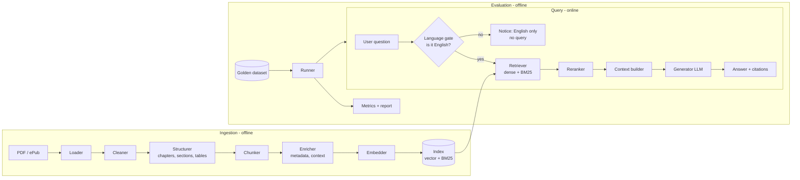

# Architecture — RAG Q&A on "The Triathlete's Training Bible"

> Current scope: **Q&A about the book only**. Primary goal: understand RAG in practice and **measure its quality**.
> Language: **English only** for questions and answers.
> Out of scope (for now): multilingual, plan generation, zone calculation, athlete profile, Strava/Garmin data integration.

---

## 1. Knowledge model: why the book is not "just text"

The book holds several kinds of content, which behave very differently in a RAG system:

| Kind | Examples | Problem in RAG | Strategy |
|---|---|---|---|
| **Narrative prose** | training philosophy, limiters, recovery, tapering | Few problems: the ideal case | Chunking by section, semantic retrieval |
| **Tables and numeric rules** | zone percentages of LTHR, weekly hours by period/annual hours, mesocycle length | A naive chunker **splits tables**; embeddings capture numbers poorly; the LLM tends to "interpolate" invented values | Extract tables as **atomic units** (never split), in Markdown, with a textual caption describing what they contain |
| **Workout descriptions** | workout codes and descriptions by ability | Very similar to each other → retrieval confuses neighbouring workouts | One chunk per workout + metadata (sport, ability, period) |
| **Figures and image tables** | charts, illustrations, some tables published as images | They are pixels: a text RAG cannot see their content. Image tables are the most critical (numbers) | **Now:** a `figure` block with just the caption, so we know a figure was there. **Future:** transcription/description with Claude's multimodality (see roadmap, "Later") |

**Golden rule:** when an answer depends on a number, that number must come *literally* from a retrieved, cited chunk.
In the future ("coach" phase) these rules will become **deterministic code** (tools), and RAG will remain to explain the *why*.
For now, in pure Q&A, handling them well during chunking is enough — and it is an excellent test bed for evaluation.

---

## 2. Overview

Two separate pipelines, connected only by the index.



---

## 3. Ingestion pipeline

| Step | Responsibility | Practical notes |
|---|---|---|
| **Loader** | Extracts raw text from PDF/ePub | ePub is much cleaner than PDF (the HTML structure is already there). For PDF: `pymupdf`. |
| **Cleaner** | Removes headers/footers, page numbers, hyphenation, artifacts | Always inspect the output by hand: this is where half of the quality problems start. |
| **Structurer** | Rebuilds the hierarchy: part → chapter → section; isolates tables and sidebars | Produces a structured `Book`, saved as JSON in `data/processed/`. |
| **Chunker** | Splits into `Chunk`s | Interchangeable strategies (see §5). |
| **Enricher** | Adds metadata and, optionally, generated context | `chapter`, `section`, `page`, `content_type` (prose/table/workout), `sport`. |
| **Embedder** | Computes vectors | Interchangeable model (see §6). |
| **Index** | Persists vectors + lexical index | For one book (~1–3k chunks) an in-memory / on-file index is enough. |

Each step produces an artifact on disk → it can be inspected, versioned (locally) and only the changed step re-run.

---

## 4. Query pipeline

1. **Language gate** — a local, deterministic check: if the message is not in English, it returns a notice and **the pipeline stops** (no retrieval, no LLM calls). See §4.1.
2. **Retriever** — hybrid:
   - *dense* (cosine similarity between embeddings) → captures meaning;
   - *BM25* (lexical) → captures exact terms ("Build 2", "LTHR", "Zone 5b").
   - Fusion with **Reciprocal Rank Fusion (RRF)**. Retrieves a wide top-k (e.g. 20–30).
3. **Reranker** — a cross-encoder reorders the candidates and keeps the best (e.g. 5). Usually the biggest single improvement.
4. **Context builder** — formats the chunks with ID and reference (chapter/section/page), deduplicates, respects a token budget.
5. **Generator** — the LLM answers **only** from the context, cites chunk IDs, and says "not in the book" when needed. It always answers in English.

### 4.1 Language: English only (for now)

Questions and answers are **English only**, the same language as the book. This way retrieval has no cross-language issues (BM25 and embeddings compare English text with English text) and the pipeline stays simple.

**Language gate** — the first step of the pipeline, before any cost:
- **local, deterministic** detection with `lingua-py`, restricted to a small set of languages (EN, IT, ES, FR, DE) to be more accurate;
- non-English message → the pipeline returns a fixed notice and **does not run the query**:
  > *"I can only answer questions in English for now. Please rephrase your question in English."*
- **very short messages** (e.g. fewer than 3 words: "LTHR?", "Build 2") or low confidence → **let through**. Detection on short texts is unreliable, and blocking a legitimate question is worse than letting a doubtful case through;
- the method's terms (Build, LTHR, Zone 5b) are already English, so they cause no problems.

The gate is a single function (`is_english` in `language.py`), called at the start of `answer()`: when multilingual support arrives, it is replaced there.

### Conversation design (Q&A)

- **Language:** English only; messages in other languages get the language gate notice.
- **Persona:** an expert, concise coach who cites sources ("Friel, ch. 7 — Base period").
- **Grounding:** no claim without a citation; if the context is not enough it says so explicitly instead of using general knowledge.
- **Guardrails:** no medical diagnoses; on pain/injuries it refers to a professional.
- **Copyright:** summarizes and paraphrases, does not reproduce long passages verbatim.
- **Multi-turn:** a follow-up question is rewritten as a standalone question (*condensation*) before retrieval: "and how long does it last?" → "How long does the Build period last?".

---

## 5. Chunking strategies (to compare)

| Strategy | Description | When it wins |
|---|---|---|
| **Fixed-size + overlap** | N tokens with overlap | Baseline: simple, gives a reference point |
| **Structure-aware** | One chunk per section/subsection, split only if too long; tables intact | Well-structured books like this one |
| **Contextual chunking** | Each chunk is prefixed with 1–2 LLM-generated sentences that place it in the book ("This passage, from the chapter on the Base period, describes…") | Chunks that are ambiguous on their own (pronouns, "this period") |
| **Parent-child** | Small chunks are indexed, but the wider "parent" section is passed to the LLM | Questions that need wide context |

---

## 6. Initial technology choices

Every external library lives in a single module (see §8): changing it touches one file.

| Component | Initial choice | Alternative to try |
|---|---|---|
| Language | Python 3.12+, managed with `uv` | — |
| Extraction | `ebooklib` + `beautifulsoup4` (ePub) / `pymupdf` (PDF) | — |
| Embedding | local `BAAI/bge-m3` (free; multilingual, so already ready for the future) | Voyage AI (API) |
| Vector index | in memory with `numpy` (brute force: with few chunks it is instant and instructive) | LanceDB / Qdrant |
| Lexical | `rank-bm25` | — |
| Reranker | local `BAAI/bge-reranker-v2-m3` | Rerank via API |
| Language gate | local `lingua-py` (no LLM call) | — |
| Generation LLM | Claude (`claude-sonnet-5-5`) via the `anthropic` SDK | — |
| Judge LLM (eval) | Claude (`claude-opus-5-5`) | — |
| Config | YAML + `pydantic` | — |
| UI (later) | CLI → Streamlit/Gradio | — |

**Long-context baseline:** besides RAG, we implement a `Generator` that receives **the whole book** in context (with prompt caching), if it fits in the model's window. Comparing it with RAG in the eval is the most instructive way to understand when RAG is really needed.

---

## 7. Evaluation

Evaluation is the heart of the project: **every change to the pipeline is a measured experiment**.

### 7.1 Golden dataset

File `eval/datasets/golden.jsonl`, one line per question:

```json
{
  "id": "q-042",
  "question": "How long does the Base period typically last and how is it divided?",
  "category": "factual",
  "reference_answer": "…hand-written answer…",
  "relevant_chunk_ids": ["ch07-s02-c01", "ch07-s02-c02"],
  "language": "en"
}
```

- **50–100 questions** written by hand (time well spent: you read them and understand the book).
- **Categories** (to see *where* the pipeline fails):
  - `factual` — a fact in one precise place;
  - `table` — the answer is in a table (numbers);
  - `conceptual` — explanation of a concept;
  - `multi_hop` — needs several sections;
  - `out_of_scope` — not in the book → the correct answer is to say so;
  - `follow_up` — second question of a conversation.
- **Synthetic** questions generated by the LLM from the chunks help increase volume, but must be **reviewed by hand**.
- All questions in **English**, plus a `non_english` category (~10 messages in IT/ES/FR, plus a few edge cases: short messages, English with a foreign term) to test the language gate. For these the expected answer is the notice, with zero chunks retrieved.
- `relevant_chunk_ids` depend on the chunking: they are also stored as **text/section spans**, so they are remapped automatically when the chunking strategy changes.

### 7.2 Retrieval metrics (deterministic, cheap)

| Metric | Question it answers |
|---|---|
| **Hit rate@k** | Is at least one relevant chunk in the top k? |
| **Recall@k** | What fraction of the relevant chunks is in the top k? |
| **MRR** | How high does the first relevant chunk appear? |
| **nDCG@k** | Overall quality of the ranking |

If retrieval is poor, no prompt will save generation: optimize retrieval **first**.

### 7.3 Generation metrics (LLM-as-judge)

| Metric | What it measures |
|---|---|
| **Faithfulness / groundedness** | Is every claim supported by the retrieved context? (anti-hallucination) |
| **Answer correctness** | Does the answer agree with the `reference_answer`? |
| **Answer relevance** | Does it really answer the question? |
| **Citation accuracy** | Do the cited chunks really support the sentences they are attached to? |
| **Refusal correctness** | On `out_of_scope`, does it say "not in the book" instead of inventing? |
| **Gate accuracy** | Does the language gate block non-English messages and let English ones through? *Deterministic*: precision/recall on blocking, no judge. A false block on an English question is the most serious error. |

Good practices for the judge:
- **Explicit rubric** with a small scale (e.g. 1–3 or pass/fail) and reasoning before the score.
- **Calibration:** label ~30 answers by hand and measure agreement with the judge before trusting the numbers.
- A judge from a different/stronger model than the generator, temperature 0.

### 7.4 Experiments

- Each experiment = a `configs/experiments/<name>.yaml` file (chunker, embedder, k, reranker, prompt, model).
- The runner saves to `eval/runs/<timestamp>-<name>/`: the config used, per-question output, aggregate metrics **per category**.
- A report compares two runs side by side (metric deltas + questions that got worse).
- **Cost and latency** per question are tracked too.

---

## 8. Code design

Simple: functions in a few modules (see `docs/steering/structure.md`). The variants to compare in experiments are **functions with the same signature in a dictionary**, picked by name from the config:

```python
# chunking.py
CHUNKERS = {"fixed": fixed_size_chunks, "sections": section_chunks}

# retrieval.py
RETRIEVERS = {"dense": dense_search, "bm25": bm25_search, "hybrid": hybrid_search}


# qa.py
def answer(question: str, index: Index, llm: LLM, cfg: QAConfig) -> Answer:
    if not is_english(question):
        return Answer.not_english()
    candidates = RETRIEVERS[cfg.retriever](question, index, cfg.top_k)
    context = (
        rerank(question, candidates, cfg.rerank_k) if cfg.rerank else candidates[: cfg.rerank_k]
    )
    return generate(question, context, llm, cfg.prompt)
```

An experiment = a new config, not a code change. `index` and `llm` are passed as parameters, so tests replace them with fakes.

---

## 9. Data and copyright

- The book (`data/raw/`) and all its derivatives (`data/processed/`, `data/index/`) **must never be committed** (they are in `.gitignore`, and a pre-commit hook refuses them).
- Strictly personal use with a legally owned copy. Public distribution would require revisiting the approach (licence or reworded content).
